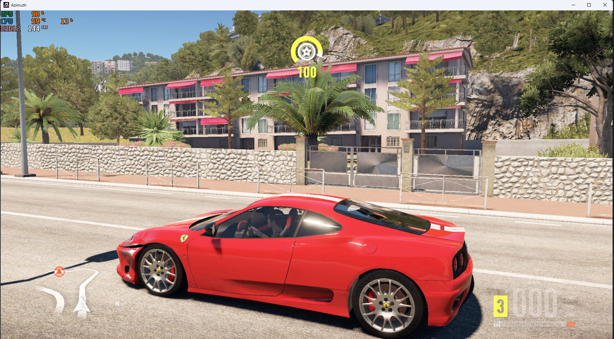

<div align="center">

# FH2 FPS Unlocker

**Take Forza Horizon 2 beyond 60 FPS on Azimuth.**

Choose your frame-rate limit from the original Azimuth interface.

**30 · 60 · 90 · 120 · 144 · 165 · 180 · 200 FPS**

Experimental preview · Windows x64 · MIT-licensed mod source

[Getting started](#getting-started) · [Test results](#test-results) · [Troubleshooting](#troubleshooting) · [Technical notes](TECHNICAL.md)

**[Download v1.0](https://github.com/gabrielfriasw/fh2_frame_unlocker/releases/tag/v1.0)** — choose `fh2-fps-unlocker-v1.0-windows.zip` under Assets. No Python installation needed.

</div>

---



*In-game screenshot supplied by the tester. The overlay reads 144 FPS at this moment; this is not a sustained-performance benchmark.*

## What it does

Adds 30, 60, 90, 120, 144, 165, 180 and 200 FPS to Azimuth's original **Frame rate** selector. The launcher uses your selected installation directly and applies executable patches only in memory. No frame generation is used.

## Getting started

1. Download **fh2-fps-unlocker-v1.0-windows.zip** from the release and extract it.
2. Save and close Azimuth, then open **FH2-FPS-Unlocker.exe**.
3. On first launch, select your existing **azimuth.exe**. Its game folder must already be configured in Azimuth.
4. Choose **Frame rate** in the original interface and start the game. Begin testing at 90 FPS.

Next time, open the same unlocker executable. It remembers the installation. No Python installation or additional installation folder is required for the Windows package. Your existing saves remain in use, and progress is saved in the same installation.

Above 60 FPS, real-time pacing is enforced. Other graphics settings are retained; VSync or external limits can restrict achieved FPS.

**Compatibility:** Windows 11 x64, the supported Azimuth 0.9.7 build and FH2 Xbox One 1.0.0.64 executable. Exact hashes are checked; see [TECHNICAL.md](TECHNICAL.md). Other builds are refused. Compatibility with third-party modifications is unverified.

To select another installation, run:

```powershell
.\FH2-FPS-Unlocker.exe --setup
```

Source users can run `python unlock.py` with 64-bit Python and Tkinter. Development used Python 3.14. `Run.cmd` uses the Windows Python launcher.

## Test results

These measurements come from **earlier fixed-limit prototypes on one PC**, using 90-second capture windows. They are not benchmarks of the newly integrated selector.

| Selected limit | Average presentations/s | Observed behavior |
|---|---:|---|
| 60 FPS | 59.96 | Tester reported normal driving |
| 90 FPS | 89.47 | Tester reported stable driving |
| 180 FPS | 110.69 | A later crash reported `D3D12 DEVICE_HUNG` (`0x887a0006`) |
| 200 FPS | 137.48 | No crash during the capture at 1080p/low; 33 dropped presentations |

**A 200 FPS setting does not mean the game reaches 200 FPS.** Presentation measurements also do not independently prove that every frame contains a unique game render.

The cause of the 180 FPS crash has not been established. Neither 180 nor 200 FPS is considered validated stable. Dedicated driving tests at 120, 144 and 165 FPS remain outstanding, and physics, AI, animations and events have not been exhaustively validated at higher rates.

For the integrated preview, seven automated instruction-emulation test methods passed, and all additional choices were confirmed visible in the original UI. Those checks do not replace in-game testing.

## Saves and reverting

Before each launch, saves are backed up under `%LOCALAPPDATA%/FH2FPSUnlocker/profiles/<profile>/save-backups`. This folder also contains a configuration snapshot and session journals. Backups can accumulate over time.

The mod uses the installation you selected. To restore a save, close Azimuth, preserve its current `data/saves` directory, and restore the chosen backup's `saves` directory there.

To stop using the mod, close it and start Azimuth normally. Executable patches disappear when the process exits. FPS choices saved in Azimuth's configuration remain; select 30 or 60 in the normal interface. Setup does not rewrite the installation's configuration or executable files.

## Troubleshooting

| Problem | What to check |
|---|---|
| Unsupported build | Compare the hashes in TECHNICAL.md. Do not bypass the check. |
| Game folder not found | Configure the game folder in Azimuth, close it, then retry setup. |
| Only 30/60 appear | Start through FH2-FPS-Unlocker.exe. |
| FPS below the selected limit | Check VSync, external caps and hardware load. The limit is a ceiling. |
| Azimuth already running | Save and close it before launching the mod. |
| Crash or unusual behavior | Return to a lower cap and record the conditions. |

## Helping test

Community reports are useful when the conditions can be reproduced:

1. Establish a 60 FPS baseline, then repeat the same route at 90 FPS.
2. Keep weather, camera, resolution and graphics settings consistent.
3. Capture frametimes and note steering, collisions, race timers, animations and crashes.
4. Test 120 FPS before proceeding to higher limits.
5. Close and reopen through the unlocker to check that the selected limit persists.

For a bug report, include:

```text
Azimuth / game build:
CPU / GPU / RAM:
Windows / graphics driver:
Selected FPS / observed FPS:
Resolution / graphics / VSync:
Route or event:
Steps to reproduce:
Expected / actual behavior:
Does it also happen at 60 FPS?
```

Review diagnostics before sharing them: journals can contain local paths. Do not attach saves, memory dumps, game assets or proprietary executables.

## Development

The launcher uses Python's standard library. Instruction-emulation tests additionally use Unicorn:

```powershell
python -m pip install -r requirements-dev.txt
python -m unittest discover -s tests -v
```

| File | Purpose |
|---|---|
| `unlock.py` | First-run folder selection and launch entry point |
| `engine.py` | Compatibility checks, save backups and process patching |
| `native_patches.py` | Extended selection in Azimuth's original UI |
| `parser_patches.py` | Saved-rate parsing and dynamic frame pacing |
| `tests/` | Instruction-emulation tests |

Run `Build.cmd` with 64-bit Python installed to build `dist/FH2-FPS-Unlocker.exe`. It uses the pinned PyInstaller dependency and its [one-file, windowed mode](https://www.pyinstaller.org/en/stable/usage.html). Bundled Python and third-party runtime components retain their own licenses.

Read [TECHNICAL.md](TECHNICAL.md) for addresses, evidence and validation limits. Contributions should keep exact-build checks, reversible patching and clear test evidence.

## Credits and license

Thanks to the Azimuth developers and the community testing Forza Horizon 2 on PC.

This is an independent, unofficial project, not affiliated with or endorsed by Microsoft, Xbox, the Forza developers or the Azimuth developers.

The [MIT license](LICENSE) covers this project's own mod code. Azimuth and Forza Horizon 2 remain the property of their respective owners. Bring your own installation; this repository does not distribute their executables or assets.
